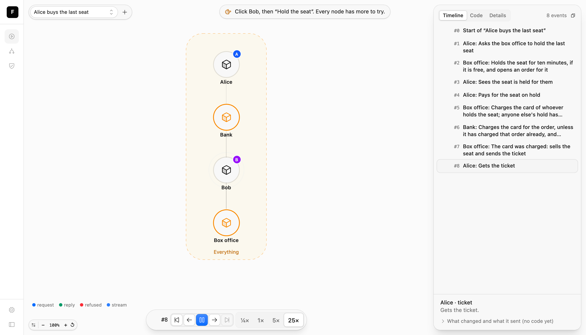
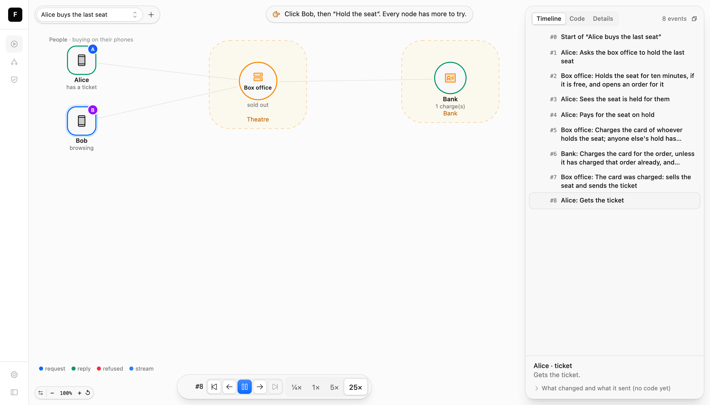
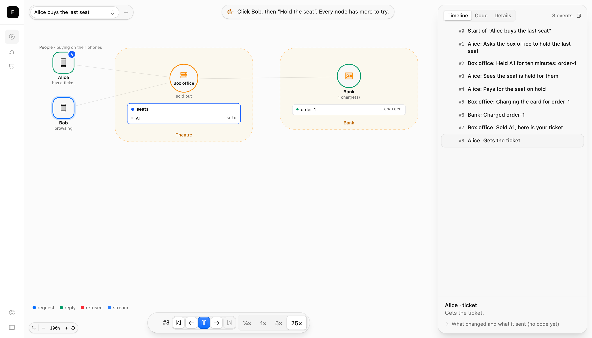
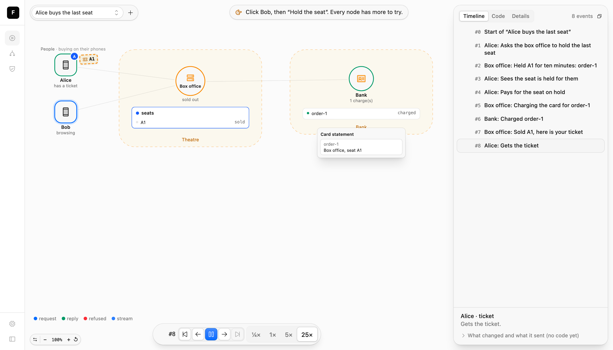
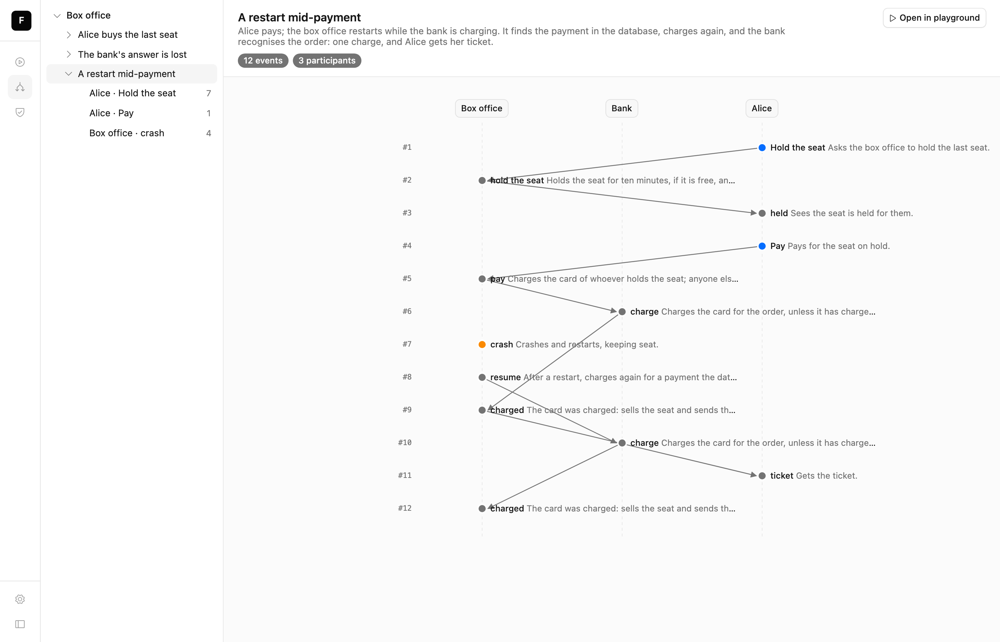
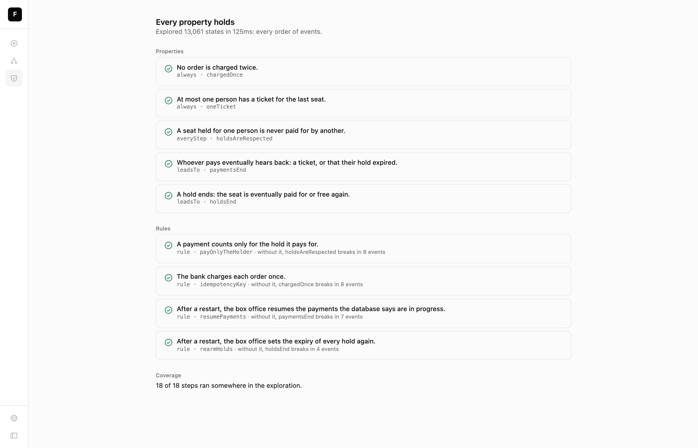

# 14. Explaining it to the new person

> *Can someone who has never seen this system understand it in ten minutes?*

A spec that only the checker reads is half used. The same file gives a newcomer a map of the
system, a playground to try it in, the flows that matter drawn as sequence diagrams, and the
checks with their stories. None of it is written separately. It's all derived from the spec,
so it can't drift from it.

This chapter takes the final box office and makes it worth looking at, one step at a time.
The verdicts never change: everything here is about how the spec reads, not what it says.

## Opening the explorer

```sh
feynman dev            # serves the explorer, and reloads it on every save
feynman build          # one self-contained HTML file, to send or host
feynman open           # builds, and opens it
```

The explorer has three pages: the **playground**, the **flows**, and the **checks**.

## Step 1: what you get for free

Here is the box office with every bit of presentation taken out: no icons, no statuses, one
zone for everything ([`specs/14-explaining/1-bare.ts`](specs/14-explaining/1-bare.ts)). Open
its playground on the first scenario:



Even bare, it's usable. Each instance is a node, and Alice and Bob get a colour each. Every
event lands in the timeline on the right, in the words of its `description`. Clicking a node
shows what it can do: the person's actions are buttons, and what's in flight can be delivered,
or lost if the spec allows it. The hint at the top says what to try next. But you can't tell a
phone from a bank, or whether the seat is sold.

## Step 2: at a glance

Four things on each actor make the map readable
([`specs/14-explaining/2-at-a-glance.ts`](specs/14-explaining/2-at-a-glance.ts)):

```ts
const people = defineZone({ name: "People", description: "buying on their phones", place: { column: 0 } });
const theatre = defineZone({ name: "Theatre", description: "the box office", place: { column: 1 } });
const bank = defineZone({ name: "Bank", description: "the card processor", place: { column: 2 } });
```

```ts
const BoxOffice = defineActor({
  name: "Box office",
  zone: theatre,
  // …
  display: {
    icon: "server",
    status: (s) => (s.seat.kind === "free" ? "the last seat is free" : s.seat.kind === "sold" ? "sold out" : `the last seat is ${s.seat.kind}`),
    mood: (s) => (s.seat.kind === "sold" ? "off" : s.seat.kind === "free" ? "ok" : "busy"),
  },
```

```ts
const Person = defineActor({
  name: "Person",
  zone: people,
  // …
  display: {
    icon: "phone",
    names: ["Alice", "Bob"],
    status: (s) => (s.ticket ? "has a ticket" : s.phone),
    mood: (s) => (s.ticket ? "ok" : s.phone === "done" ? "off" : "busy"),
  },
```

- **`icon`** says what it is. Services (`server`, `cloud`, `database`, `card`) are drawn as
  circles, devices (`phone`, `laptop`) as rounded squares.
- **`status`** is a few words under the name, from the actor's state.
- **`mood`** colours it: `ok`, `warn`, `bad`, `busy`, `off`, `info`. The bank goes `bad` if it
  ever charges an order twice, so a reader who replays the bug *sees* it.
- **`names`** label the people a reader adds with `+`.
- **Zones** box the parts of the system by concern. `place.column` orders them left to right,
  the way the money moves.



## Step 3: inside, and in words

Two more things turn the map into an explanation
([`specs/14-explaining/3-inside.ts`](specs/14-explaining/3-inside.ts)).

**Rows** show state as structure. The box office shows its seat, and what it keeps in memory.
The bank shows its charges:

```ts
    rows: (s) => [
      s.seat.kind === "free"
        ? { label: "A1", detail: "free", mood: "ok", group: "seats" }
        : s.seat.kind === "sold"
          ? { label: "A1", detail: "sold", mood: "off", group: "seats", owner: s.seat.to }
          : { label: "A1", detail: `${s.seat.kind}, ${s.seat.order}`, mood: "busy", group: "seats", owner: s.seat.by },
      ...(s.expiring ? [{ label: "expiry timer", detail: "10 minutes", group: "in memory" }] : []),
      ...(s.calling ? [{ label: "waiting on the bank", group: "in memory" }] : []),
    ],
```

`owner` gives the row the colour of whoever holds the seat, so a reader follows Alice's blue
from her phone to *her* seat. The "in memory" group is there on purpose. When the box office
crashes, a reader sees those rows vanish while the seat stays, which is chapter 9 in one picture.

**`say`** is the sentence the timeline shows for one event, instead of the step's general
`description`:

```ts
    hold: {
      on: Hold,
      description: "Holds the seat for ten minutes, if it is free, and opens an order for it.",
      say: (s) => (s.seat.kind === "held" ? `Held A1 for ten minutes: ${s.seat.order}` : "Sorry, A1 is taken"),
```

```ts
      say: (s, msg) => (s.charges.filter((o) => o === msg.order).length > 1 ? `Charged ${msg.order} AGAIN` : `Charged ${msg.order}`),
```

It reads the state *after* the step, and the message it received. Compare the timelines:
"Box office: Holds the seat for ten minutes, if it is free, and opens an order for it" becomes
"Box office: Held A1 for ten minutes: order-1".



Keep these functions small, and only about the actor's own state. They run on every frame.

## Step 4: the ticket

Some things are worth more than a row: a ticket in Alice's hand. A **token** is something an
instance holds that a person could carry to another node
([`specs/14-explaining/4-ticket.ts`](specs/14-explaining/4-ticket.ts)):

```ts
    tokens: (s, self) => (s.ticket ? [{ kind: "ticket", value: "A1", label: `A1, ${self.label}` }] : []),
```

It floats beside the phone. If another actor had an action whose input `accepts: "ticket"`
(an usher at the door, say), dragging the ticket onto the usher would run it. That's the most
memorable way to show a hand-off between actors: a pairing code typed on a laptop, a link
pasted in a chat.

And when the defaults can't show something, a **playground file** beside the spec can
([`specs/14-explaining/4-ticket.play.tsx`](specs/14-explaining/4-ticket.play.tsx)):

```tsx
import { Card, definePlayground, Panel, Ticket } from "@leostera/feynman/play";
import spec, { Bank, BoxOffice, Person } from "./4-ticket.ts";

export default definePlayground(spec, (play) => {
  play.token("ticket", ({ token, holder }) => <Ticket code={String(token.value)} label={`${holder.label}'s ticket`} />);

  play.actor(Bank, {
    panel: ({ state }) =>
      state.charges.length === 0 ? null : (
        <Panel title="Card statement">
          {state.charges.map((order, i) => (
            <Card key={i} title={order}>
              {state.charges.indexOf(order) === i ? "Box office, seat A1" : "Box office, seat A1 (again!)"}
            </Card>
          ))}
        </Panel>
      ),
  });

  // The sequence diagram reads left to right as the money moves.
  play.flow("Alice buys the last seat", [Person, BoxOffice, Bank]);
});
```

The ticket is drawn as a ticket, and the bank opens a card statement once it has charged:



The rules for a playground file:

- **It only draws.** The checker, the flows and the diff never load it. Delete it and the
  playground still works.
- **It changes nothing except through `act`**, which runs a declared action exactly as a
  button does.
- **It can only show what the state holds.** To show the card statement, the bank's state must
  keep its charges. Add state for a picture only if it's true to the system, and the verdicts
  stay the same.
- **`feynman check` type-checks it** with the spec. A panel that reads `state.payments`, which
  doesn't exist, fails the check:

  ```text
  book/specs/14-explaining/4-ticket.play.tsx:11:13 Property 'payments' does not exist on type 'Readonly<{ charges: string[]; seen: Set<string>; }>'.
  ✗ 1 type error(s) in book/specs/14-explaining/4-ticket.play.tsx, listed at the top: the results above may come from code that does not compile
  ```

Write one rarely. Icons, statuses, rows and tokens are nearly always enough.

## Flows

Every scenario is a flow: a sequence diagram of its events, with the `description` beside each.
Here is the restart mid-payment:



This is the page to send someone who asks "what happens if the server restarts while it's
charging?" Read down: the crash at #7 is orange because it's a fault, the resume at #8 sends a
second charge, the first charge's answer arrives anyway at #9, and the bank recognises the
second at #10. *Open in playground* starts the playground from the same flow, to try the
other orders.

This is why scenarios are written for readers (chapter 6). Each one should be a story somebody
asks about.

## Checks

The checks page is `feynman check` for people who won't run it:



The headline is as strong as the weakest verdict. Here every property holds; one that only
"held in the states explored" would say so first. Put the bounds the spec needs in `feynman.config.ts`, so
the explorer and the CLI agree without flags:

```ts
import { defineConfig } from "@leostera/feynman/config";

export default defineConfig({ specs: ["specs/*.ts"], check: { instances: { Person: 2 } } });
```

## A tour for a newcomer

A ten-minute route through any spec:

1. **The map.** Zones and icons: what the parts are, and who talks to whom.
2. **One flow.** The scenario of the happy path, read top to bottom.
3. **The playground.** Start that flow, then go back a few events and try something else:
   another person, a lost message, a restart.
4. **The checks.** What must always be true, and the rules that keep it so. Each rule says what
   breaks without it. That's the reason the code is the way it is.
5. **The code.** On a step, *Code* shows the sources it points at, and what they call.

The spec does the explaining. Your job as its author is to keep it legible: plain descriptions,
a `say` on the steps that matter, the state a reader needs to see as rows, and scenarios for
the questions people ask.

## Exercises

1. Add a `say` to `expired` on the person, so the timeline shows "Alice: too late, the hold had
   run out".
2. Make the box office's `mood` `warn` while it's waiting on the bank. When does a reader see
   it?
3. Add an Usher with an action `admit` whose input `accepts: "ticket"`, and a property that
   nobody is admitted without a ticket. Drag Alice's ticket onto the usher.
4. Pick a spec from `packages/feynman/examples/` and do the tour. What was the first thing you
   didn't understand? Which line of the spec would fix it?
